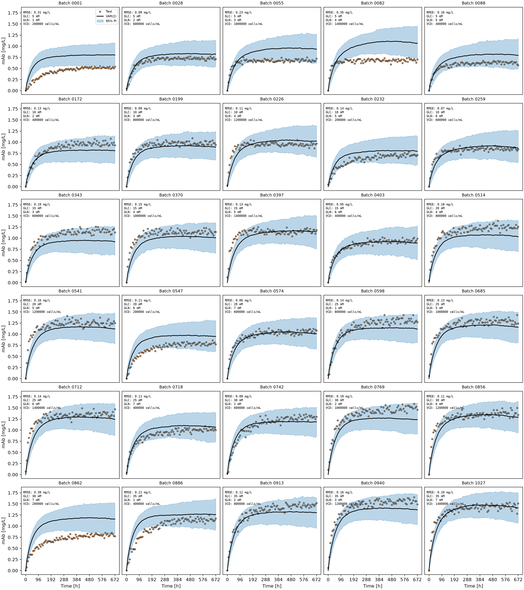
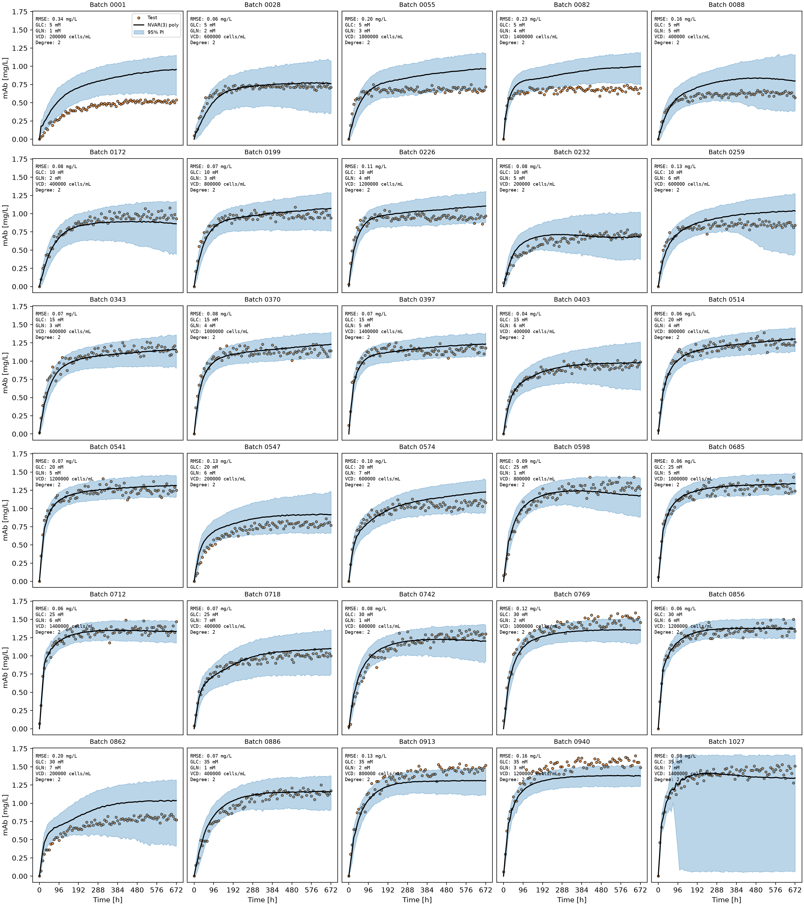
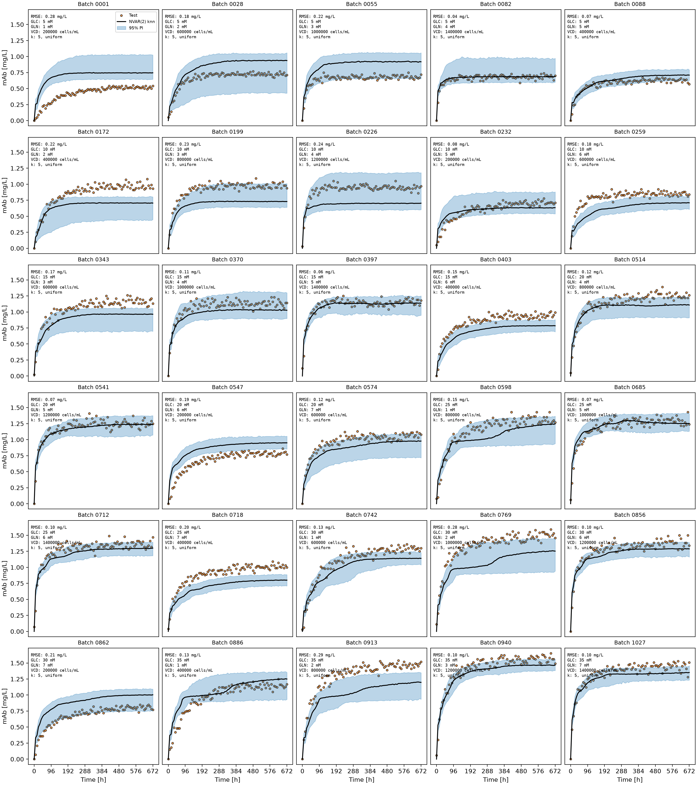
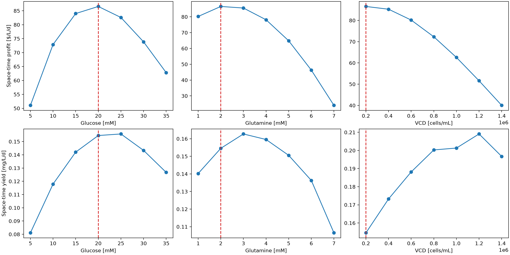

# Data Driven Optimization of Monoclonal Antibody Production
This project uses time series measurements from batch bioreactors to predict monoclonal antibody production under various initial operating conditions. Linear and non-linear vector autoregressive models are evaluated using batch level cross validation and forecast uncertainty. The resulting predictions can be used to investaige how inital gl

## Highlights
- Selected 30 batch runs to cover different combinations of initial glucose, glutamine, and viable cell density (VCD).
- Built VAR and nonlinear VAR (NVAR) models to forecast seven variables throughout a batch culture.
- Compared nine forecasting configurations using leave-one-batch-out validation and recursive forecast RMSE.
- Selected polynomial NVAR(3) after achieving the lowest mean forecast RMSE of 0.11 ± 0.06 mg/L.
- Optimized 343 initial-condition combinations and identified a four-day harvest with predicted profit of $86.55/(L·d).

## Environment 
- Python 3.14.7
- NumPy 2.5.2
- Pandas 3.0.5
- Matplotlib 3.11.0
- scickit-learn 1.9.0

## Code Design
The program operates through running the code located in main.py. When main.py is run, it begins by reading the inititial_conditions.csv and 30 batch files stored in the datasets/ directory. In main.py, Path("datasets").glob("batch_*.csv") locates the batch files. A loop loads each file with pd.read_csv(), extracts the numeric batch identifier from its filename, and inserts a Batch ID column. pd.concat() merges the individual DataFrames, after which the observations are sorted by batch and time. The separate initial conditions table supplies the starting values needed to generate forecasts.

### Features and Lagged Inputs
The process state includes seven measured variables: glucose, glutamine, lactate, ammonia, VCD, total cell density (TCD), and monoclonal antibody (mAb) concentration. Batch ID and Time [h] are retained for data organization but excluded from the regression features using df.columns[2:]. The evaluation target, mAb [mg/L], is identified separately because antibody concentration is needed for the economic objective. 

The generate_x_lag_cur_var() function constructs pairs of inputs and targets from each batch. x_lag_train contains the previous p process states, while x_cur_train contains the following measured state. With seven variables sampled every eight hours, orders p = 1, 2, and 3 provide 7, 14, and 21 lagged inputs. The function constructs these pairs within each batch, so values from one experiment are not used as the history of another.

### Model Architecture
A linear variance model is implemented using make_pipeline(StandardScalerVAR(p=p), LinearRegression()). StandardScalerVAR scales each process variable consistently across its lagged positions, which is necessary because cell densities are several orders of magnitude larger than the concentration measurements. Linear regression predicts the next values of all seven variables together, using the history of the entire process state rather than mAb history alone.
The NVAR models retain the same inputs and outputs while allowing nonlinear relationships. The polynomial pipeline adds PolynomialFeatures(include_bias=False) before LinearRegression(); the comparison searches degrees 2 and 3 to capture interactions and curvature. The k-nearest-neighbours (k-NN) pipeline uses KNeighborsRegressor() and searches 2–5 neighbours with uniform weights. Both use the same lag orders and training data. The selected final optimization pipeline fixes polynomial degree 2.

### Validation 
Both VAR and NVAR are evaluated using leave-one-batch-out cross-validation. For each of the 30 iterations, one complete batch is excluded and the remaining 29 are used for training. A new model is fitted for every excluded batch and lag order. This prevents observations from the test batch appearing in the training data and evaluates how the models perform on independent culture runs.

NVAR also uses GridSearchCV with GroupKFold(n_splits=3) for parameter selection within the training batches. Batch IDs define the groups so that time points from the same batch remain in one fold. A custom score_mab() function evaluates one-step predictions using negative mAb RMSE, avoiding domination by variables with much larger numerical units, especially cell densities. Polynomial degree and k-NN neighbour count are tuned separately. Model selection relies on full recursive forecast RMSE, not the one-step tuning score.

### Recursive Forecasting and Uncertainty
Each test forecast begins from its known initial glucose, glutamine, and VCD. Lactate, ammonia, and mAb are initialized at zero, and initial TCD is set equal to VCD. Predictions are generated one time step at a time; each predicted state is appended to the forecast history and becomes an input for the next prediction. If fewer than p previous states are available initially, the latest known state is repeated to form the required input vector.

For each held-out batch, 1,000 simulations estimate forecast variability. Residuals are calculated by subtracting measured training states from the model's one-step predictions. At each simulated time step, a residual is sampled separately for each process variable and added to the predicted state. Negative values are clipped to zero. NVAR also clips its baseline predictions to the observed training range for each variable before adding noise, limiting extreme nonlinear extrapolation. The median simulated mAb trajectory is compared with observations using RMSE; the 2.5th and 97.5th percentiles form the 95% prediction interval.

### Figures and Results
When run_model_comparison is enabled, main.py creates 6 × 5 figures, each showing observed mAb, the forecast median, 95% prediction intervals, initial conditions, and RMSE for 30 held-out batches. Batch-level RMSE summaries are exported to tables/var_results.csv and tables/nvar_results.csv. The saved results support selecting polynomial NVAR(3); the comparison is disabled by default so the optimization can run without repeating all nine models.

### Economic Optimization and Outputs
After model selection, degree-2 polynomial NVAR(3) is trained on all 30 batches. The optimization section forecasts mAb production for 343 combinations of initial glucose, glutamine, and VCD. For each combination, culture cost is calculated from the starting conditions and space-time profit is evaluated at each possible harvest time. The program selects the combination and harvest time with the highest predicted profit, including the required one-day downtime between batches.

The initial search uses direct, noise-free model predictions. Once the best conditions are identified, 1,000 simulations are run at that operating point to estimate 95% prediction intervals for culture value, space-time profit, and yield. This limits the computational cost of the uncertainty analysis. The results are saved in tables/optimization_grid.csv and tables/optimization_summary.csv. The forecast comparison produces var_results.csv, nvar_results.csv, and 6 × 5 plots of the held-out batches; initial_condition_effects.png shows how changing one starting variable affects predicted profit and yield.

## Analysis
Thirty of the 1,029 available runs were selected from the initial-conditions table to vary glucose, glutamine, and VCD rather than taking 30 consecutive files. Selection used starting conditions rather than mAb outcomes, avoiding an outcome-driven bias. All seven levels of each starting variable are represented, emphasizing operating-range coverage rather than replication.

The primary advantage is broader coverage of the operating conditions. A model trained on several different nutrient concentrations and cell densities has a better opportunity to learn how the process changes across the design space. This is useful because the final optimization searches combinations beyond the 30 selected cultures. However, in this method there is no replication, meaning that there could be variability between runs that is unexplored. Repeated experiments would have helped estimate how much variation occurs between runs started under the same conditions. Not every combination of the three inputs is represented. As a result, predictions for untested combinations still depend on the model's ability to generalize from a fairly small number of batches.

### Usage of Multivariable Autoregression
The mAb concentration changes throughout a culture, alongside nutrient consumption, metabolite accumulation, and cell growth. These measurements are related over time, so treating every row as an independent observation would ignore an important part of the process. Vector autoregression is a suitable starting point because it predicts the next values of all seven process variables from their recent values. This also means that predicted mAb concentration can respond to changes in the other process measurements instead of depending only on previous mAb values. 

Linear VAR was tested first because it offers a relatively simple baseline. It can represent relationships between variables, but the shape of a batch culture is not necessarily linear. The mAb plots show a quick increase during the earlier stages followed by a slower rise or plateau. The effect of nutrients and cell density may also change as the culture develops. Polynomial regression and k-nearest neighbours were therefore tested as nonlinear alternatives rather than assuming that adding more lags to a linear model would be enough.

Three lag orders were compared. VAR(1) and NVAR(1) use the previous 8 hours of process measurements, while models with two or three lags include 16 or 24 hours of history. Extra lags can help distinguish a temporary change from a longer-term trend, but they also increase the number of inputs. Polynomial NVAR(3) has 21 original lagged inputs, which become 252 features after a degree-2 polynomial transformation. That added flexibility may improve forecasting, but it also creates a greater risk of overfitting when only 29 batches are available in each training fold.

The nonlinear hyperparameters were selected using grouped cross-validation. Keeping batches together was especially important here: measurements only eight hours apart are closely related, and allowing one batch into both training and validation would make the results look better than they should. One remaining limitation is that GridSearchCV assesses one-step predictions, whereas the final task involves forecasting a complete batch from its starting conditions. The recursive forecast results were therefore given more weight when deciding which model to keep.

### Linear VAR Performance
The linear models were evaluated using leave-one-batch-out testing and 1,000 simulated forecasts for every held-out batch.

Table 1: VAR Results

|p                                       |N simulations                                   |RMSE (mean) [mg/L]|RMSE (SD) [mg/L]|
|----------------------------------------|------------------------------------------------|------------------|----------------|
|1                                       |1000                                            |0.173             |0.085           |
|2                                       |1000                                            |0.157             |0.079           |
|3                                       |1000                                            |0.160             |0.073           |
Adding a second lag reduced the mean RMSE from 0.17 to 0.16 mg/L. A third lag did not improve the rounded mean error, although the standard deviation was slightly lower. VAR(2) was chosen as the linear baseline because it performed almost as well as VAR(3) with fewer inputs. The small differences between the two models did not provide a strong reason to prefer the more complex version.

*Figure 1. Observed and predicted mAb concentrations using VAR(2), with 95% prediction intervals.*

The plots highlight the limitations of relying on RMSE alone. VAR(2) generally captures the initial increase in mAb concentration, but it sometimes predicts a higher final concentration than the culture actually reaches. Batches 0001, 0082, and 0862 show this behaviour clearly, with RMSE values of roughly 0.31, 0.35, and 0.39 mg/L. Batch 0403, by comparison, is predicted much more closely, at approximately 0.05 mg/L. The difference between batches suggests that the model works better for some starting conditions than others.

Prediction intervals also tend to spread out over longer forecasts. This is expected because each forecast step depends on preceding predictions. However, a wide interval does not necessarily indicate a reliable model: the median can still be consistently too high or too low. The residuals were sampled to represent white noise, but the code does not formally test whether they are independent or whether the resulting intervals contain 95% of future observations. The uncertainty bands should therefore be treated as estimates rather than guaranteed bounds.

### Nonlinear Models and Model Selection
The same batches and forecast procedure were used to compare polynomial and k-NN NVAR models. Polynomial degree and k-NN neighbour count were tuned using the training batches, and the final errors were calculated from recursive mAb forecasts. The plotted polynomial NVAR models use degree 2.

Table 2: NVAR Results.

|Model                                   |p                                               |N simulations|RMSE (mean) [mg/L]|RMSE (SD) [mg/L]   |
|----------------------------------------|------------------------------------------------|-------------|------------------|-------------------|
|poly                                    |1                                               |1000         |0.159             |0.102              |
|poly                                    |2                                               |1000         |0.124             |0.072              |
|poly                                    |3                                               |1000         |0.108             |0.064              |
|knn                                     |1                                               |1000         |0.164             |0.072              |
|knn                                     |2                                               |1000         |0.153             |0.071              |
|knn                                     |3                                               |1000         |0.162             |0.083              |

Polynomial NVAR(3) was selected because it had the lowest mean RMSE and the lowest standard deviation across the 30 batches. Its mean error of 0.11 mg/L was about 31% lower than VAR(2), based on the rounded values. This improvement over the linear baseline indicates that nonlinear terms help capture the dynamics of mAb production.

The comparison with polynomial NVAR(2) was closer. NVAR(2) achieved 0.12 ± 0.07 mg/L, so the third lag only improved mean RMSE by 0.01 mg/L. The improvement is modest relative to the additional polynomial features. Still, NVAR(3) performed slightly better on both reported measures, making it the preferred option for the final optimization. The results support the choice for these 30 batches, not necessarily for other datasets.

k-NN produced less accurate forecasts overall. Its best configuration, NVAR(2), achieved 0.15 ± 0.07 mg/L, only a small improvement over VAR(2). The k-NN forecasts often follow a similar pattern across batches, but their plateaus can miss the measured values. Polynomial regression appears better able to represent the changing shape of these particular production curves.

*Figure 2. Observed and predicted mAb concentrations using second-degree polynomial NVAR(3), with 95% prediction intervals.*

*Figure 3. Observed and predicted mAb concentrations using k-nearest neighbours NVAR(2), with 95% prediction intervals.*

The selected model nevertheless has several limitations. For batch 0001, the NVAR(3) forecast continues above the measured plateau, producing an RMSE of about 0.34 mg/L. Batch 0862 is also overpredicted, with an RMSE of approximately 0.20 mg/L. At the other extreme, batch 1027 has a fairly small RMSE of about 0.08 mg/L but an unusually broad prediction interval near the end of the run. These errors are relevant to optimization because the predicted antibody concentration determines product value at harvest. A systematic error in that concentration directly changes the estimated product value and profit.

Polynomial forecasts were clipped to the observed training ranges before residual noise was added. This prevents some extreme predictions as errors accumulate, but it can also hide behaviour that genuinely extends beyond the observed data. The model's strong average performance does not remove the need to examine its forecasts at the recommended operating conditions.

### Space-Time Profit and Yield
The objective is not simply to maximize mAb concentration. A batch also costs money to start and takes time that could otherwise be used for another run. The project uses the following economic relationships:

- Cell culture cost [$/L] = 10 × (Initial Glucose [mM]) + 20 × (Initial Glutamine [mM]) + 0.0005 (Initial VCD [cells/mL])
- Cell culture value [$/L] = 1000 × (mAb [mg/L])
- Profit [cost/L]  = (Cell culture value  [$/L]) - (Cell culture cost [$/L])
- Space-time profit [$ / (L ⋅ d)] = (Profit [/L]) / ((Harvest time [d]) + (Downtime [d]))
- Space-time yield [mg / (L ⋅ d)] = (mAb [mg/L]) / ((Harvest time [d]) + (Downtime [d]))

Here, initial glucose and glutamine are measured in mM, initial VCD in cells/mL, and harvest time in days. The extra day accounts for the downtime required between batches. Space-time profit includes the cost of nutrients and starting cells, whereas space-time yield measures the amount of mAb produced per litre per day without accounting for that cost. The conditions that give the highest yield may therefore not give the highest profit.

Polynomial NVAR(3) was refitted using all 30 batches and used to evaluate 343 starting-condition combinations across available harvest times. The initial ranking uses noise-free forecasts; 1,000 residual-noise simulations at the selected point then provide 95% prediction intervals for value, profit, and yield. These intervals describe uncertainty in the predicted outcome at that point, not whether it is certainly the best operating condition. The search is also limited to the provided initial-condition grid. Harvest timing matters because the model predicts rapid mAb accumulation early in the run followed by slower gains. Keeping a batch in operation after production slows increases the cycle time without a proportional increase in product value. Conversely, harvesting too early sacrifices accumulated mAb, and the required downtime makes very short cycles less efficient.

### Recommended Operating Conditions
The highest predicted space-time profit occurs at 20 mM glucose, 2 mM glutamine, and 200,000 cells/mL initial VCD, with a 4.00-day harvest. One day of downtime gives a five-day cycle. The estimated culture cost is $340.00/L: $200 from glucose, $40 from glutamine, and $100 from starting cells.

Table 3: Summary of economic evaluation results.

|Initial glucose [mM]|Initial glutamine [mM]|Initial VCD [cells/mL]|Harvest time [d]|Cell culture cost [$/L]|Cell culture value [$/L]|Value 95% PI lower [$/L]|Value 95% PI upper [$/L]|Space-time profit [$/L/d]|Profit 95% PI lower [$/L/d]|Profit 95% PI upper [$/L/d]|Space-time yield [mg/L/d]|Yield 95% PI lower [mg/L/d]|Yield 95% PI upper [mg/L/d]|
|--------------------|----------------------|----------------------|----------------|-----------------------|------------------------|------------------------|------------------------|-------------------------|---------------------------|---------------------------|-------------------------|---------------------------|---------------------------|
|20.0                |2.0                   |200000.0              |4.0             |340.0                  |772.7291917928534       |622.8199989044004       |923.9908121678421       |86.54583835857068        |56.56399978088009          |116.79816243356842         |0.15454583835857066      |0.12456399978088009        |0.18479816243356845        |

The predicted mAb concentration at harvest is 0.773 mg/L. Subtracting the 340.00/L cost from the $772.73/L value and dividing by five days gives the reported profit.

*Figure 4. Effect of initial glucose, glutamine, and viable cell density on predicted space-time profit and yield. Dashed red lines indicate the conditions selected to maximize profit.*

In Figure 4, Harvest time is re-optimized at each point; dashed lines identify the recommended conditions.

Profit peaks at an intermediate glucose concentration of 20 mM, where additional nutrient cost begins to outweigh production gains. Increasing glutamine from 2 to 3 mM slightly improves yield but reduces profit. Higher VCD has an even clearer trade-off: raising it from 200,000 to 1,200,000 cells/mL increases predicted yield from 0.155 to 0.209 mg/(L·d), but reduces profit from $86.55 to $51.59/(L·d) due to starting cell cost.

The full grid confirms that the highest yield is not the most profitable option. The maximum predicted yield, 0.241 mg/(L·d), occurs at 30 mM glucose, 4 mM glutamine, and 1,400,000 cells/mL, with harvest around 4.33 days; profit there is only $38.10/(L·d). Meanwhile, a nearby option of 20 mM glucose, 3 mM glutamine, and 200,000 cells/mL gives $85.57/(L·d), less than $1 below the optimum. That small difference relative to forecast uncertainty, together with the optimum occurring at the lowest available VCD, means the result should be treated as the best model-predicted choice within the tested grid, not a guaranteed global optimum. If additional experiments were possible, nearby glutamine concentrations and lower starting VCD values would be useful candidates for validation before changing the process operating procedure.
